# E-Waste EcoBot

E-Waste EcoBot is a chat assistant for responsible electronic-waste management. You can ask what to do with an old device, upload a photo of it, look up nearby recycling centers on a map, or get a repair-versus-recycle recommendation with a carbon estimate.

The answers are grounded in Indian e-waste documents. Those PDFs are split into chunks, stored for semantic search, and passed to Gemini as reference passages before a reply is written. A separate scoring model decides whether a device should be repaired, recycled, or disposed of, and Gemini explains that decision in plain language.

<p align="center">
  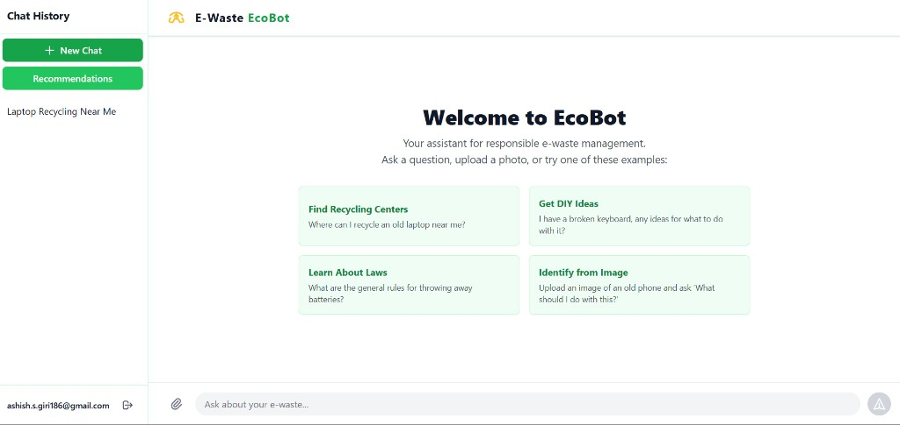
</p>

## What you can do

| Feature | What it does |
| --- | --- |
| RAG chat | Answers questions on disposal, repair, donation, and e-waste rules using retrieved document chunks |
| Image questions | Accepts a photo of a device and asks Gemini what to do with it |
| Nearby centers | Uses your location, filters authorized centers within 20 km, and plots them on a Mapbox map |
| Recommendations | Turns a device description into structured fields, then scores repair, recycle, or dispose |
| Chat history | Saves sessions per signed-in user and can retrieve earlier turns as extra context |
| Evaluation | Runs a small test set and reports similarity and fluency of bot replies |

The home screen offers four starting points: find a recycling center, get DIY ideas for a broken device, learn the rules for batteries, or identify an item from a photo.

<p align="center">
  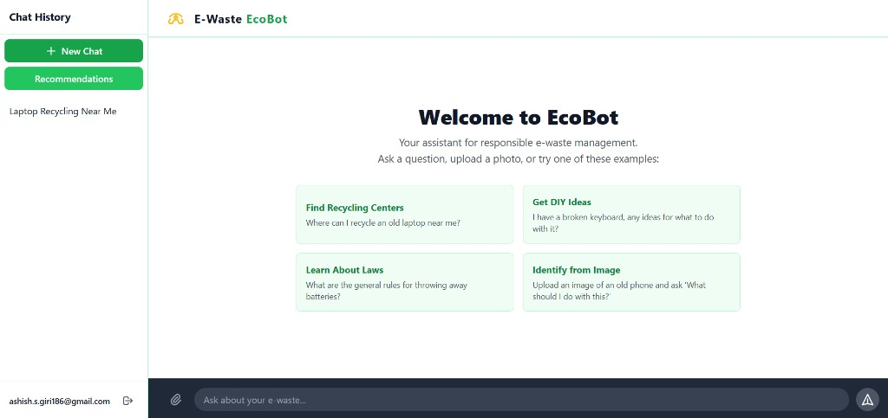
</p>

## Recycling centers

Location questions such as “Where can I recycle an old laptop near me?” ask the browser for permission to use your position.

<p align="center">
  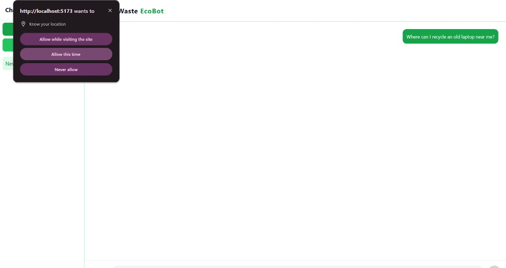
</p>

If permission is denied, the search falls back to Wagholi, Pune. Centers come from a static list of 26 authorized recyclers in and around Pune (`data/recyclingCenters.ts`). The app keeps the ones inside a 20 km radius, lists the name and address in the chat, and opens an interactive map. Each pin links out to Google Maps for directions.

<p align="center">
  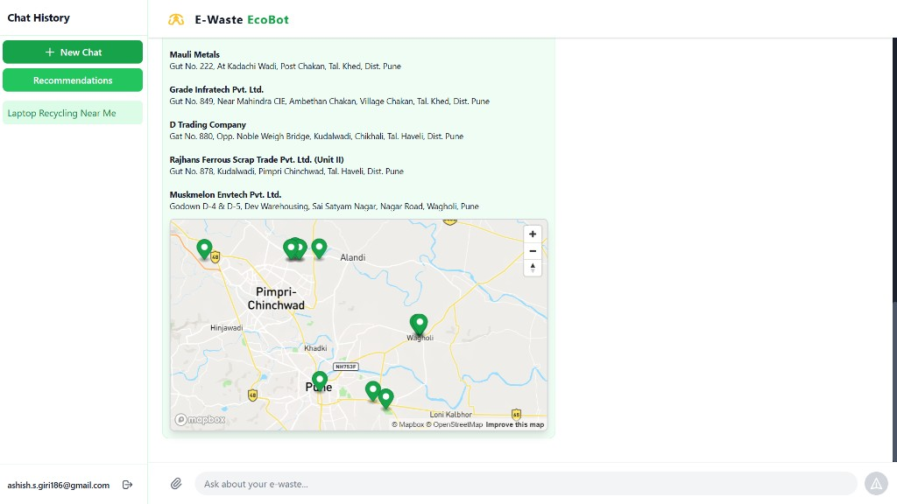
</p>

An earlier version of the same flow listed the nearest centers with a **View on Map** button when a larger result set was returned.

<p align="center">
  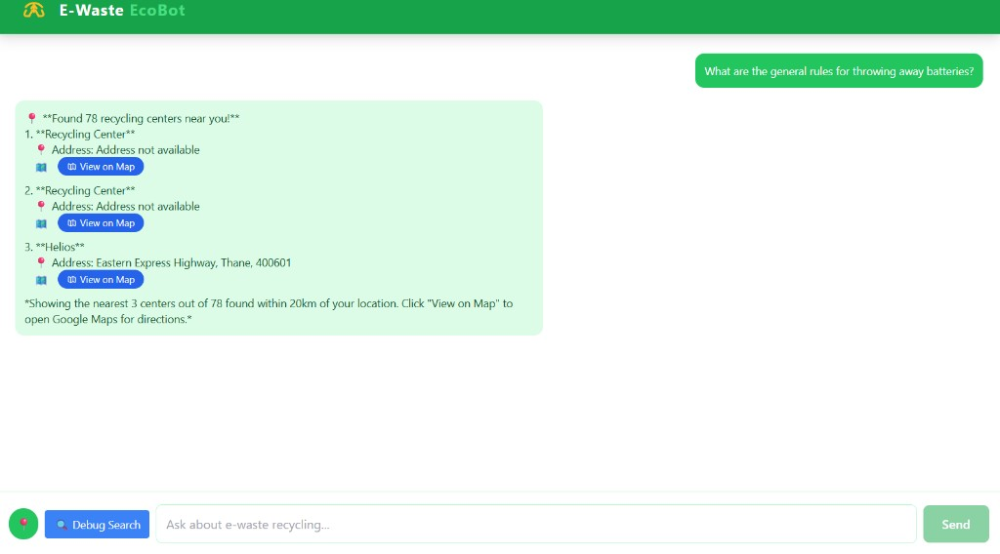
</p>

## Repair, recycle, or dispose

The **Recommendations** panel is separate from the chat. You can describe a device in a sentence, for example a 3-year-old phone with a cracked screen, and Gemini extracts item type, age, condition, estimated value, repair cost, spare-part availability, hazard flag, material, and weight.

<p align="center">
  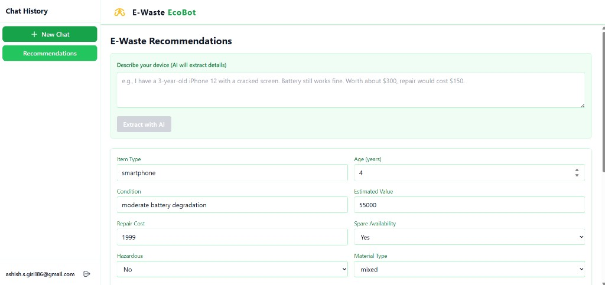
</p>

Those fields feed a local scoring model:

- **Repair score** weighs age, condition, value, spare availability, repair cost relative to value, and whether the item is hazardous. Phones, laptops, and appliances use different age limits and weights.
- **Carbon impact** starts from the material (battery is highest, then metal, mixed, plastic, and glass), then adjusts for device type, age, and condition.
- **Carbon savings** multiplies that impact by the device weight, reported in kg CO₂e.
- **Decision** is Repair, Recycle, or Dispose. Hazardous items and poor repair economics move the result toward recycling.

Gemini then writes a short explanation of why that option was chosen. The example below is a 4-year-old smartphone with moderate battery degradation: repair score 0.62, carbon impact 4.85, estimated savings 2.42 kg CO₂e, overall score 0.53, recommendation **Repair**.

<p align="center">
  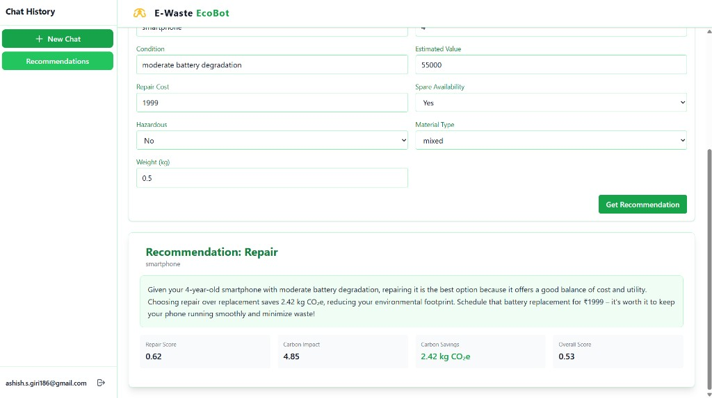
</p>

## How a chat answer is built

1. You sign in. Accounts live in the browser for this demo. Chat sessions are stored in `localStorage` under that email.
2. On login, the vector service connects to ChromaDB at `localhost:8000` and loads the PDF knowledge base. If ChromaDB is not running, search falls back to keyword matching over the same chunks.
3. Your message is embedded and matched against document chunks and, when available, earlier chats from the same user.
4. The top passages are inserted into the prompt as reference text. The system prompt tells EcoBot to stay concise: a direct answer, short bullets, safety notes, and a next step.
5. Gemini 2.5 Flash returns the reply. Location questions skip the generic model wording and instead list the filtered recycling centers, with the map attached to the message.
6. New chats get a short title generated from the first message. The sidebar keeps those sessions so you can reopen or delete them.

The knowledge base was extracted from three source PDFs and chunked at roughly 280 words:

| Document | Chunks | Role |
| --- | --- | --- |
| E-waste management guidelines | 32 | Health effects, management practice, Indian scenario |
| E-waste status in India | 53 | Current status and context |
| Government e-waste rules | 88 | Rules and compliance language |

That is 173 chunks and about 48,000 words, checked into `data/pdfDocuments.ts` so the app still has source material without the original PDFs.

## Architecture

A person using EcoBot can ask an e-waste question, view recycling centers, request a recommendation, or pull information that originated in the PDFs. The system reaches ChromaDB for retrieval, Gemini for generation, and Mapbox for the map.

<p align="center">
  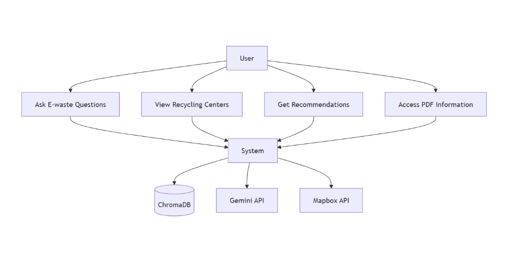
</p>

The three product features share the vector store, the static data folder, and the Gemini service.

<p align="center">
  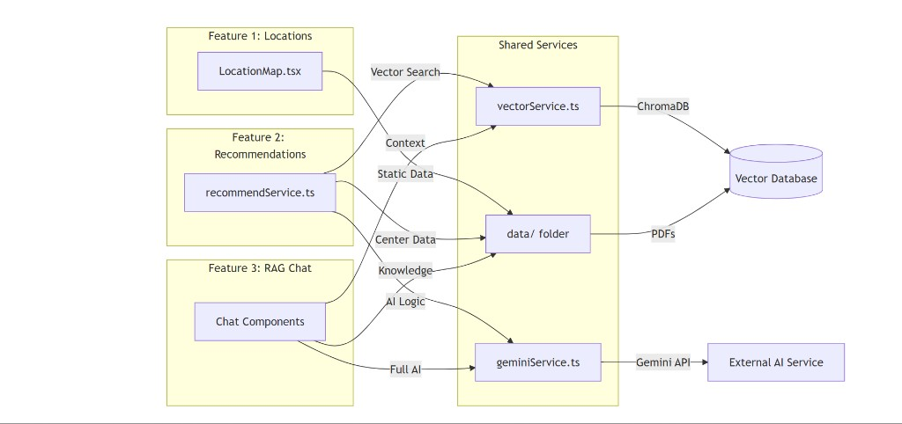
</p>

Offline, PDFs go through text extraction, chunking, embedding, and loading into ChromaDB. At runtime a user query is searched, the relevant chunks go to Gemini, and the reply can cite that context. Recycling-center coordinates stay in the static TypeScript data file rather than in the vector store.

<p align="center">
  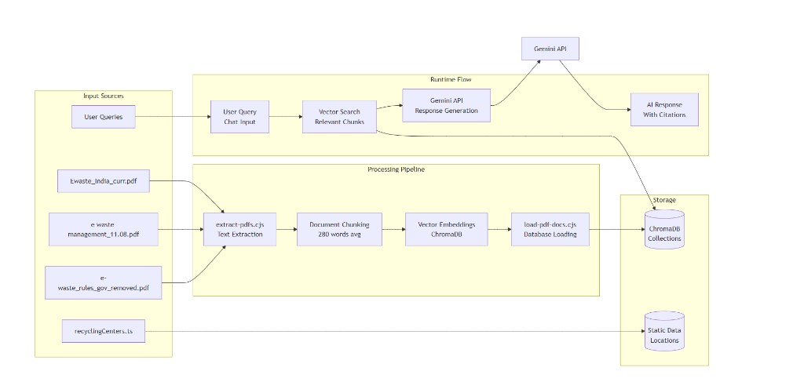
</p>

The code is split the same way: a React and Mapbox interface, an application layer (`App.tsx` plus services for auth, recommendations, vectors, and Gemini), scripts that extract and load PDFs, and external calls to Gemini and Mapbox.

<p align="center">
  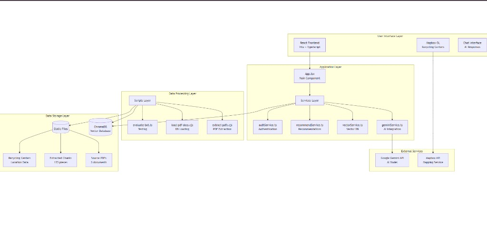
</p>

## Tech stack

- **UI:** React 19, TypeScript, Vite
- **Model:** Google Gemini (`@google/genai`) for chat, titles, image questions, field extraction, and recommendation explanations
- **Retrieval:** ChromaDB with the default embedding function, plus a keyword fallback
- **Maps:** Mapbox GL, with Google Maps links for directions
- **Documents:** `pdf-parse` for extraction, chunks stored as TypeScript
- **Scoring and evaluation:** local repair and carbon formulas, `natural` and `string-similarity` for the evaluation script

## Project layout

```text
App.tsx                         Session state, geolocation, nearby-center filter
components/
  WelcomeScreen.tsx             Example prompts
  ChatWindow.tsx / ChatMessage  Replies, images, and the map
  LocationMap.tsx               Mapbox markers
  RecommendationForm.tsx        Extract-and-score form
  AuthPage.tsx / Sidebar.tsx    Demo login and chat history
services/
  geminiService.ts              RAG prompt and Gemini chat
  vectorService.ts              ChromaDB collections and fallback search
  recommendService.ts           Repair, carbon, and decision scores
  recommendLLMService.ts        Description extraction and explanation
  authService.ts                Browser-only sign-in
data/
  recyclingCenters.ts           Pune-area recycler coordinates
  pdfDocuments.ts               Chunked knowledge base
scripts/                        PDF extract, Chroma load, evaluation
```

## Run it locally

You need Node.js. ChromaDB is optional. The chat still answers from the checked-in chunks if the database is down. Python or Docker is only needed if you want the vector server.

1. Install dependencies:

   ```bash
   npm install
   ```

2. Copy the env template and add your own keys:

   ```bash
   copy .env.example .env.local
   ```

   - `GEMINI_API_KEY` from [Google AI Studio](https://aistudio.google.com/apikey)
   - `MAPBOX_ACCESS_TOKEN`, a public `pk.` token, from [Mapbox](https://account.mapbox.com/access-tokens/)

3. Start the app:

   ```bash
   npm run dev
   ```

4. Open the local URL Vite prints, create an account on the sign-in screen, and try one of the welcome prompts.

`.env.local` is gitignored. Do not commit it. `node_modules`, `dist`, and the `chroma` folder are ignored as well.

### Optional: ChromaDB

```bash
npm run chromadb:install
npm run chromadb
```

Or with Docker:

```bash
docker run -p 8000:8000 chromadb/chroma
```

Leave that process running, then start `npm run dev` in a second terminal. More detail is in [VECTOR_DATABASE_SETUP.md](VECTOR_DATABASE_SETUP.md).

### Other scripts

| Command | Purpose |
| --- | --- |
| `npm run extract-pdfs` | Pull text out of PDFs in the project |
| `npm run convert-pdf-to-ts` | Write chunks into `data/pdfDocuments.ts` |
| `npm run load-pdf-docs` | Load those chunks into ChromaDB |
| `npm run evaluate-bot` | Score replies in `test-data.json` and write `evaluation-results.txt` |
| `npm run build` | Production build |

## Notes for anyone cloning this

Sign-in is a classroom demo. Emails and a stand-in password string are kept in `localStorage`, and the session is kept in `sessionStorage`. It is not a real authentication backend.

Gemini and Mapbox keys are read from `.env.local` and injected when Vite builds the page. They are not in the source, but a deployed frontend bundle will still contain them because the calls are made from the browser. Restrict both keys in their dashboards, and rotate them if a build was ever shared.

The recycler list covers the Pune region used for this project. Adding a city means extending `data/recyclingCenters.ts` with a name, address, latitude, and longitude.
